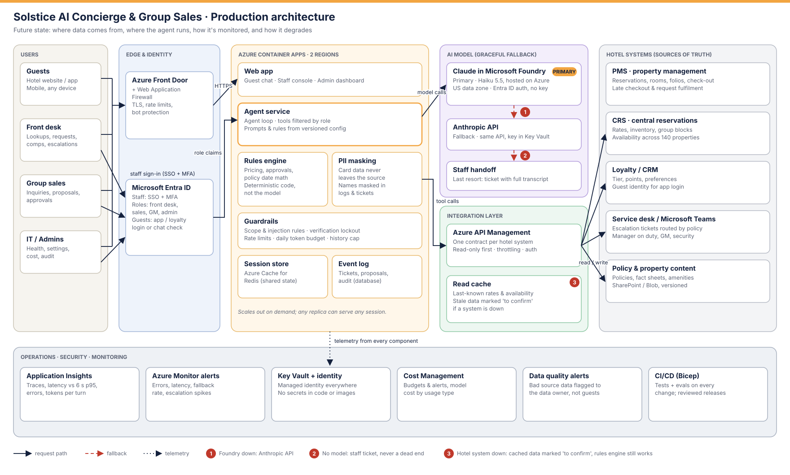
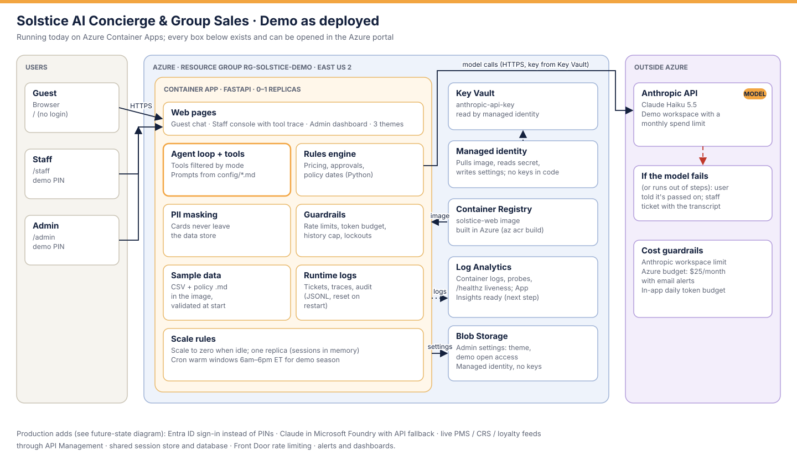

# Architecture

Current build vs. future-state production.

## Future-state production architecture

- **Where data comes from:** the hotel's PMS (reservations, rooms), CRS (rates, inventory, group blocks), loyalty/CRM (tier, points, guest identity) and policy content, reached through Azure API Management, read-only first. Card data never leaves the source system.
- **Where the agent runs:** Azure Container Apps in two regions behind Azure Front Door, with shared session state (Redis) so any replica can serve any session. Staff sign in with Entra ID (SSO + MFA); the agent's tools are chosen by the user's role.
- **How it's monitored:** Application Insights traces every turn (latency vs. the 6 s p95 target, errors, tool calls, tokens); Azure Monitor alerts on errors, latency, fallback rate and escalation spikes; Cost Management budgets; data quality alerts go to the data owner.
- **How it degrades:** (1) Foundry unavailable → Anthropic API; (2) no model at all → a staff ticket with the full transcript, never a dead end; (3) a hotel system down → last-known cached data marked "to confirm", while the rules engine keeps working.

## Demo as deployed

Both diagrams are generated by `docs/diagrams/build_diagrams.py` (edit and re-run: `python docs/diagrams/build_diagrams.py`). The SVGs drop straight into PowerPoint.

## Hosting decision (2026-11-18)

**Chosen: Azure Container Apps (consumption plan) + Claude in Microsoft Foundry.**

| Piece | Choice | Why |
|---|---|---|
| Web app | Azure Container Apps, consumption plan, standard environment | Scales to zero; the monthly free grant (180,000 vCPU-s, 360,000 GiB-s, 2M requests per subscription) covers demo traffic. Standard (not "express") environment so a custom domain is possible. |
| Model | Claude Haiku 5.5 in Microsoft Foundry, Hosted on Azure, Data Zone Standard (US) | Billed on the Azure invoice; runs on Azure infrastructure in the US data zone; Entra ID auth instead of an API key. |
| Secrets | Azure Key Vault, accessed by the app's managed identity | No keys in code, config files or container images. |
| Identity | Container Apps built-in authentication with Microsoft Entra ID for staff/admin | Replaces the demo PINs with SSO + MFA, no auth code to write. See `docs/ACCESS_CONTROL.md`. |
| Monitoring | Application Insights + Log Analytics | Latency vs. target, errors, tool calls, token use. |
| Infrastructure | Bicep (based on Microsoft's Claude-on-Foundry starter kit), deployed with `az` | Repeatable, reviewable, easy to tear down. |

**Options considered**

| | A: Container Apps + Foundry (chosen) | B: App Service | C: Lightweight host |
|---|---|---|---|
| Hotel IT credibility | Strongest | Strong | Weak |
| Monthly cost (demo) | ~$0–5 + tokens | ~$10–15 fixed + tokens | ~$0 + tokens |
| Setup effort | Highest | Medium | Lowest |
| Entra SSO / Key Vault / managed identity | Yes | Yes | No |
| Cold start | Yes (min 1 replica on demo day) | No | Varies |
| Demo matches production story | Yes | Mostly | No |

**Why A:** a hotel group's IT shop most likely runs Microsoft. Every claim in the deck about security, monitoring and degradation points at something running in the Azure portal, not a slide. B was the runner-up (simpler, always on, but fixed cost and a weaker scale story). C was rejected: third-party host holds the API key and nothing shows the enterprise path.

## Model provider and graceful degradation

The provider lives in one file, `backend/solstice/agent/llm.py`. Planned order:

1. **Claude in Foundry** (primary).
2. **Anthropic API directly** (fallback if Foundry is unavailable or rate-limited; same Messages API).
3. **No model available:** the agent tells the guest it can't help right now and creates a staff ticket with the conversation, so it's never a dead end.

Pricing, approvals and policy date math are deterministic Python and keep working regardless of the model.

## Model provider today (decided 2026-11-18)

The subscription was upgraded from Free Trial to **pay-as-you-go** (spending limit off), so Claude in Foundry is now available. **Decision: stay on the Anthropic API for now.**

- **Why:** the demo already shows the hard parts (Azure hosting, Key Vault, managed identity, monitoring, graceful degradation), and the direct API gets new Claude features first. Foundry adds governance (one Azure bill, identity instead of a key, US data zone, Cost Management), not lower token prices.
- **How it's secured:** the API key lives only in Key Vault; the container reads it through its managed identity.
- **Switching later:** create a Foundry resource, subscribe to the Claude offer, deploy Claude Haiku 5.5 (Hosted on Azure, Data Zone Standard US), change `backend/solstice/agent/llm.py` to the Foundry client with Entra auth, and keep the Anthropic API as the fallback. Roughly half a day including tests.

## Deployed (2026-11-18)

Running in resource group `rg-solstice-demo` (East US 2): Container App (consumption, 0–1 replicas, `/healthz` probes), Container Registry (image built in Azure with `az acr build`), Key Vault holding the Anthropic API key (read by the app's managed identity), Log Analytics + Application Insights. Model provider: Anthropic API (see "Model provider today"). Infrastructure as code: `infra/main.bicep`; runbook: `infra/README.md`.

Measured: first request after scale-to-zero took ~55 s (initial image pull); set `--min-replicas 1` before a demo.

## Current local build

- **Web app** (`backend/solstice/web/`, FastAPI + plain HTML/CSS/JS, no front-end build step; decided 2026-11-18 over Streamlit and Chainlit/Gradio for a branded, fit-for-purpose UI):
  - `/` guest concierge (no login; identity verified in chat with confirmation number + last name)
  - `/staff` front desk or group sales (staff PIN) with an "Under the hood" tool trace and an Escalations queue
  - `/admin` health, activity, settings, tools, data quality (admin PIN). Read-only except two switches saved to Blob Storage when deployed: the website theme (Appearance) and demo open access (Access)
  - Model outage or a reply that runs out of tool rounds: a staff ticket is created with the transcript, so the user is never left at a dead end.
  - Sessions are server-side tokens; agent, mode and tools are fixed at session start. Guests never receive tool inputs/outputs.
  - `/healthz` liveness probe for Container Apps. Sessions are in memory, so the demo runs one replica.
- Terminal app (`python -m solstice.cli`): mode menu (guest / front desk / group sales / admin), demo PINs.
- Data: CSVs in `data/raw/`, loaded and validated at start (`backend/solstice/data/`).
- Outputs: JSONL files in `data/runtime/` (tickets, requests, proposals, traces, audit).
- Model: Anthropic API directly, key in `.env`.
